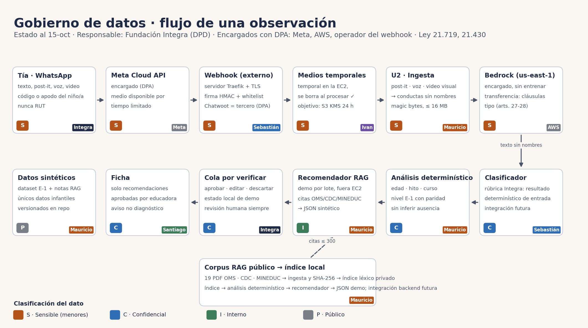

# Gobierno de datos — IntegrAI

## Demo RAG y clasificación de sus datos

Los 19 PDF OMS/CDC/MINEDUC son fuentes públicas autorizadas y se manifiestan con hash; la licencia queda `por confirmar` cuando no hay declaración redistributiva. El índice extraído permanece en `privado/`. `data/recomendaciones.json` contiene solo IDs y notas sintéticas, citas ≤300 caracteres y estado `por_verificar`; las decisiones de la preview quedan en el navegador y no se confunden con persistencia productiva.

> CDO del proyecto: Mauricio. Revisión: 15-oct-2026. Marco: Ley 19.628 modificada por la **Ley 21.719** (vigente desde el 1-dic-2026), Ley 21.430 (garantías de la niñez), Ley 21.663 (ciberseguridad) y Ley 21.459 (delitos informáticos).
> Las referencias a artículos se deben verificar en bcn.cl antes de usarlas formalmente.

## 1. Principios

1. **Interés superior del niño/a** (art. 16 quáter, Ley 21.430): ningún uso de los datos puede perjudicarlo ni estigmatizarlo. El sistema entrega **señales para revisión profesional**, nunca un diagnóstico.
2. **Finalidad única:** apoyar el seguimiento pedagógico del desarrollo. Prohibido usar los datos para otros fines (por ejemplo, entrenar modelos de terceros o comercializarlos).
3. **Minimización:** se recoge solo lo necesario. El video se usa cuando aporta lo que el texto no muestra (motricidad: pararse, sostener la cabeza, gatear); se analiza, se convierte en conductas y el archivo se borra en ≤ 24 h (hoy, al terminar de procesar). Nunca se guarda ni se reenvía la imagen del niño/a.
4. **Seudonimización:** fuera de la sala, el niño/a es `NINO-xxxxx`. El nombre solo sirve para resolver el ID y **no** se envía al clasificador, no se guarda en la observación y no aparece en logs.
5. **Humano en el loop** (art. 8 bis): el nivel lo confirma la educadora; la compuerta manda a revisión los casos dudosos.
6. **Transparencia:** cada decisión guarda su evidencia (conductas citadas), la versión del modelo y del prompt, el margen y quién confirmó.

## 2. Roles

| Rol | Quién | Responsabilidad |
|---|---|---|
| **Responsable del tratamiento** | Fundación Integra | Decide los fines y los medios; responde ante la Agencia y los apoderados |
| **Delegado de protección de datos (DPD)** | A designar por Integra (art. 50) | Supervisa el cumplimiento, es el punto de contacto de la Agencia y ARCO+ |
| **Dueño del dato** (data owner) | Dirección Técnica / Educación de Integra | Aprueba usos, accesos y cambios del modelo |
| **Administrador del dato** (data steward) | Directora de cada jardín | Calidad del roster, altas y bajas de educadoras y niños/as, primera línea de ARCO+ |
| **Custodio técnico** | Equipo DevOps (Ivan) | Infraestructura, cifrado, respaldos, accesos técnicos |
| **CDO del proyecto** | Mauricio | Este documento, clasificación, EIPD técnica, evaluación de modelos, respuesta a incidentes |
| **Encargados** (art. 15 bis, requieren DPA) | Meta (WhatsApp), AWS (EC2, S3, Bedrock), operador del webhook (Wagner Solutions), Chatwoot si se usa | Tratan solo según instrucciones de Integra; sin uso propio ni entrenamiento; borrado al terminar |

## 3. Clasificación de los datos

| Nivel | Qué incluye | Reglas |
|---|---|---|
| **S — Sensible (menores)** | Fotos, audios y videos; inferencia de nivel o rezago; nombre + niño/a; teléfono de la educadora | Cifrado en tránsito (TLS) y en reposo (KMS). Retención mínima. Acceso solo por necesidad. Nunca en el repo ni en logs |
| **C — Confidencial** | Observaciones seudonimizadas (conductas), nivel confirmado, roster, trayectorias | Cifrado. RBAC por sala y jardín. Auditoría de acceso |
| **I — Interno** | Métricas agregadas por jardín o región (k-anonimato ≥ 5), tasas de revisión, métricas del modelo | Acceso del personal de Integra; sin datos individuales |
| **P — Público** | Dataset sintético E-1, benchmarks, código, documentación | Puede estar en el repo público |

## 4. Inventario y ciclo de vida

| Dato | Origen | Finalidad | Base legal (producción) | Dónde | Clase | Retención | Borrado |
|---|---|---|---|---|---|---|---|
| Medio crudo (foto/audio/video) | WhatsApp | Extraer la observación | Consentimiento de apoderados (art. 16 quáter) | Temporal en EC2 / S3 (KMS) | S | **≤ 24 h** (hoy: se borra al procesar) | Automático (lifecycle / `finally`) |
| Transcripción | U2 | Auditoría de la lectura | Ídem | BD | S | 30 días | Job programado |
| Conductas (sin nombres) | U2 | Entrada del clasificador; evidencia | Ídem | BD (`nota`) | C | Matrícula + 1 año | Al egreso + 1 año, o por ARCO |
| Nivel propuesto / confirmado | Ensemble + educadora | Seguimiento del desarrollo | Ídem | BD | S | Matrícula + 1 año | Ídem |
| Roster (nombre ↔ ID) | Integra | Resolver a quién se refiere la nota | Relación educativa | BD (`ninos`) | S | Mientras esté matriculado | Al egreso |
| Teléfono de la educadora | Integra | Whitelist / autenticación | Relación laboral | Config / BD | S | Mientras trabaje en Integra | Al término |
| Logs de auditoría | Sistema | Trazabilidad, incidentes | Deber de seguridad (art. 14 quinquies) | CloudWatch | C | 2 años | Expiración automática |
| Agregados | Dashboard | Gestión regional | Interés legítimo / estadística | BD / reportes | I | Indefinido | — |
| Dataset sintético | Organización del evento | Desarrollo y evaluación | No es dato personal | Repo | P | — | — |

## 5. Matriz de acceso (RBAC)

| Rol | Observaciones de su sala | Otras salas del jardín | Otros jardines | Agregados | Medios crudos | Administración |
|---|---|---|---|---|---|---|
| Educadora / técnica | Ver, confirmar, corregir | — | — | — | — | — |
| Directora de jardín | Ver | Ver | — | Su jardín | — | Roster de su jardín |
| Equipo regional / nacional | — | — | — | Ver | — | — |
| DPD | Por solicitud ARCO / auditoría | Ídem | Ídem | Ver | Por incidente | Auditoría |
| DevOps | — | — | — | — | — (solo infraestructura) | Infraestructura |
| Modelo (Bedrock: Claude, Nova, TwelveLabs Pegasus para video) | Solo texto sin nombres y medios ≤ 16 MB, sin retención; el video se analiza para describir conductas y se descarta | — | — | — | — | — |

## 6. Gobierno de la IA

- **Revisión humana efectiva** (art. 8 bis): la tía confirma o corrige. La compuerta por margen manda a revisión los casos dudosos. Con U2 delante, los rezagos que se escapan bajan de 16/40 a 6/40 (`EVAL_ENSEMBLE.md` §6).
- **Explicación:** cada propuesta muestra las conductas citadas que la sustentan.
- **Evaluación obligatoria antes de cada versión:** set aleatorio + set **contra la edad** (`bench/casos_contra_edad.jsonl`) + sesgo por sexo y región. Reportar siempre "solo edad / solo texto / sistema".
- **Registro por decisión:** versión del modelo, del prompt, margen, decisor y quién confirmó.
- **Sin entrenamiento con datos reales** sin una base legal y una EIPD que lo cubra. Bedrock no usa los datos para entrenar.
- Futuro: el proyecto de ley de IA (Boletín 16.821-19) probablemente clasificará este uso como **alto riesgo**; el diseño ya anticipa supervisión humana y documentación.

## 7. Procedimientos

**Derechos ARCO+ (acceso, rectificación, supresión, oposición, bloqueo, portabilidad):** el apoderado solicita a la directora o al DPD → se verifica la identidad → respuesta en **30 días** (art. 11, verificar) → se ejecuta y queda registrado en auditoría.

**Brecha de seguridad:**
1. Detectar y contener: rotar tokens y aislar la instancia.
2. Evaluar qué datos y cuántos niños/as se afectaron.
3. Notificar a la **Agencia de Protección de Datos "sin dilaciones indebidas"** (art. 14 sexies).
4. Si hay datos sensibles o de menores, notificar a los **apoderados** en lenguaje claro.
5. Como buena práctica: alerta al CSIRT en 3 h, actualización a las 72 h e informe a los 15 días (Ley 21.663).
6. Hacer un post-mortem y actualizar este documento.

**Cambio de modelo o prompt:** evaluación (§6), aprobación del dueño del dato, registro de la versión y comunicación a las educadoras si cambia el comportamiento.

**EIPD — evaluación de impacto (art. 15 ter, obligatoria antes de producción). Índice:**
1. Descripción del tratamiento y del flujo (diagrama de arriba).
2. Necesidad y proporcionalidad.
3. Riesgos para los niños/as: error, estigmatización, filtración, sesgo.
4. Medidas (`SEGURIDAD.md`).
5. Riesgo residual.
6. Opinión del DPD.
7. Revisión anual.

## 8. Estado para la hackathon

Solo hay **datos sintéticos**. El roster con nombres de `tools/seed_roster.py` es ficticio. Sin fotos ni audios de niños reales. Las secciones 2–7 describen lo que Integra debe implementar antes de un piloto real.
