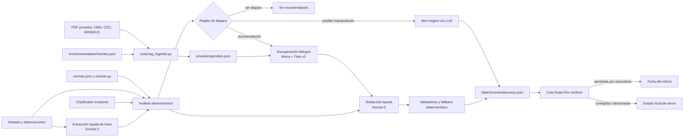

# Recomendador RAG — plan y checkpoint

**Estado: DEMO ESTÁTICA IMPLEMENTADA / UMBRALES POR VALIDAR**
**Fecha de implementación:** rama `recomendador-rag`
**Rama de trabajo:** `recomendador-rag`

> Las secciones históricas de checkpoint se conservan como trazabilidad. El estado ejecutado y las verificaciones vigentes están en **8.0** y **10.0**.

Este documento conserva el diseño aprobado y el progreso real del recomendador referenciado de IntegrAI. Es autosuficiente para retomar el trabajo sin depender de conversaciones previas. El código de este checkpoint es parcial, no está integrado en producción y no debe presentarse como una función terminada.

## 1. Objetivo y alcance de esta fase

IntegrAI es un asistente de WhatsApp para educadoras de párvulos del Desafío 1 de Fundación Integra, AWS Breaking Barriers Chile 2026. Después de normalizar una observación y clasificarla con la rúbrica de Integra, una futura estación generará una propuesta pedagógica respaldada antes de enviarla a la cola **Por verificar**:

```text
observación → normalización → clasificador → recomendador RAG → Por verificar → educadora
```

La educadora debe verificar **todas** las decisiones. Ninguna recomendación se aprueba automáticamente y solo una recomendación aprobada puede aparecer en la ficha del niño o niña. Cada salida debe mostrar exactamente este aviso:

> Propuesta para el criterio de la educadora. No es un diagnóstico.

Esta fase es una demo fuera de producción. No modifica la EC2, `webhook_ec2.py`, el clasificador, la rúbrica privada, la cola actual ni los servicios AWS. Las recomendaciones se precalcularán por lote en `data/recomendaciones.json`; el dashboard leerá ese archivo y mantendrá localmente la revisión para la demo.

## 2. Decisiones aprobadas

1. **Doble respaldo obligatorio.** Cada recomendación combina:
   - análisis determinístico: edad, estado de hitos, comparación anónima con el curso, nivel, fecha e IDs de observaciones;
   - evidencia profesional: organización, fuente, página del PDF y fragmento literal breve.
2. **Dos análisis complementarios.** Se analizan hitos concretos por niño/a y la comparación con su curso; además se compara el nivel vigente con el esperado y con la media del curso.
3. **Revisión humana universal.** Todo item nace en `por_verificar`; solo la educadora puede aprobarlo, corregirlo o descartarlo.
4. **Demo por lote.** Primero se genera un JSON estático para el dashboard. Integración backend, persistencia y WhatsApp quedan fuera de esta fase.
5. **Corpus público versionado; índice privado.** Los 19 PDF autorizados por el usuario se versionan en `RAG/` con manifiesto, hashes y licencia `por confirmar` cuando corresponde. Que sean publicaciones accesibles no implica licencia abierta. El índice con texto completo extraído vive en `privado/rag/indice.json` y no se versiona.
6. **Determinismo antes del LLM.** Edad, zonas, estado del hito, curso, brechas y reglas de disparo se calculan en código. El LLM extrae información tipada y redacta a partir de hallazgos y pasajes permitidos; no decide las reglas ni las fuentes a consultar.
7. **Modelos aprobados.** Extracción y redacción: `us.anthropic.claude-sonnet-5`; evaluación DeepEval: `us.anthropic.claude-opus-5`; embeddings: `amazon.titan-embed-text-v2:0`. No usar Sonnet 5.5 ni Haiku 5.5.
8. **UNICEF fuera de alcance por ahora.** El corpus de esta fase usa OMS, CDC y Bases Curriculares.

## 3. Principios de seguridad, privacidad y evidencia

- No enviar nombres de niños/as en prompts ni escribirlos en el JSON público. Usar identificadores sintéticos o internos no nominativos.
- Los 19 PDF autorizados se publican en `RAG/`; el índice, texto completo extraído y embeddings no se publican. Las citas expuestas por la demo no superan 300 caracteres.
- **Sin registro no equivale a no logrado.** `no_logrado` solo se asigna cuando existe una nota explícita con cita literal que sustente la negación.
- Cada afirmación debe poder trazarse a un hallazgo determinístico o a una cita profesional recuperada.
- Las citas públicas deben ser literales, de máximo 300 caracteres, e incluir fuente y página del PDF.
- No publicar los PDF, el índice, texto completo extraído, datos personales, secretos ni credenciales.
- Una detección de inyección produce un item `posible_manipulacion`, sin invocar al LLM y sin sugerencias.
- Las comparaciones de curso nunca identifican compañeros.
- Los umbrales son preliminares y deben ser validados por Integra y por un profesional de salud antes de cualquier uso real.
- El recomendador entrega apoyo pedagógico sujeto a revisión; no diagnostica ni reemplaza evaluación clínica.

## 4. Arquitectura propuesta



### Flujo de datos previsto

1. `tools/rag_ingestar.py` verifica SHA-256, extrae texto por página, fragmenta e indexa el corpus privado.
2. `fuentes.json` describe las fuentes públicas y enlaza cada metadato con un PDF privado mediante nombre y hash.
3. `normas.json` conserva umbrales y checkpoints humanos; `normas.py` expone reglas tipadas.
4. El análisis determinístico calcula hitos, zonas, comparación de curso y rezago de nivel.
5. La recuperación usa consultas en español e inglés, filtros por tipo/fuente y diversidad documental.
6. Sonnet 5 redacta únicamente desde hallazgos y pasajes recuperados, con salida tipada.
7. Validadores comprueban citas, longitud, referencias, privacidad y consistencia; ante error se usa un fallback determinístico o se deja el caso sin sugerencias.
8. El lote produce `data/recomendaciones.json` para la demo React.

## 5. Reglas determinísticas aprobadas

### 5.1 Edad y zonas del hito

La edad decimal se calcula como:

```text
edad_meses = días_transcurridos / 30,4375
```

Para cada hito se aplican cuatro zonas, con umbrales todavía **por validar**:

| Condición | Zona | Acción prevista |
|---|---|---|
| `edad < p50_OMS` | `esperable` | No recomendar por edad |
| `p50_OMS <= edad < A` | `estimular` | Proponer actividades si existe disparador |
| `A <= edad <= p99_OMS` | `atencion` | Estimular y sugerir seguimiento |
| `edad > p99_OMS` | `fuera_de_ventana` | `derivacion_salud` obligatoria, sin diagnosticar |

`A` corresponde a la edad CDC del hito —CDC define sus hitos como lo que el 75 % o más puede hacer a esa edad— o al `p75_OMS` cuando no existe un equivalente CDC.

Ejemplo preliminar: para **sentarse sin apoyo**, 9,0 meses cae en `atencion`; el `p99_OMS` se verificó preliminarmente en 9,2 meses. Estos valores no pueden marcarse como revisados hasta completar el checkpoint humano contra el PDF.

### 5.2 Estados de hito

Estados permitidos:

- `logrado`: observación explícita con cita literal.
- `logrado_inferido`: una conducta válida implica el logro según una regla aprobada.
- `no_logrado`: negación explícita con cita literal.
- `en_proceso`: intento o logro parcial explícito.
- `sin_registro`: no hay evidencia suficiente; jamás se expresa como ausencia.

La evidencia más reciente gana. Si existen evidencias incompatibles, la salida informa las contradicciones y conserva sus IDs y fechas. **Gatear no se usa como implicación**, porque puede omitirse en el desarrollo.

### 5.3 Comparación del curso

- Grupo comparable: mismo `id_jardin` y `sala_grupo`.
- `K_MIN_CURSO = 5` niños/as con algún registro del hito o análisis correspondiente.
- No identificar ni exponer datos de compañeros.
- Solo afirmar “único/último sin logro” cuando todos los demás niños/as con registro sí tienen el hito logrado.
- Si no se alcanza el mínimo, omitir la comparación y explicar que no hay base suficiente.
- `sin_registro` de un compañero no cuenta como `no_logrado`.

### 5.4 Rezago de nivel

Se debe portar **exactamente** la lógica vigente de `frontend/src/domain/consultas.ts` y `frontend/src/domain/metrics.ts`:

1. Nivel vigente: evaluación `global` más reciente; si no existe, observación más reciente.
2. Nivel esperado: primer nivel ordenado que cumpla `edadMinMeses <= meses < edadMaxMeses`; para edades sobre el último máximo, usar el último nivel.
3. Brecha: `nivel_vigente - nivel_esperado` en la misma escala E-1.
4. Alerta absoluta: `brecha <= -2`.
5. Rezago relativo: `nivel_vigente < media_sala - 1,0`.
6. Reportar siempre la escala y la fecha explícita usadas para el cálculo.

No se debe crear una segunda interpretación de estas reglas en Python sin pruebas de paridad con TypeScript.

### 5.5 Reglas de disparo

| Estado o condición | Zona | Resultado |
|---|---|---|
| `no_logrado` | `estimular`, `atencion` o `fuera_de_ventana` | Generar propuesta referenciada |
| `sin_registro` | `atencion` o `fuera_de_ventana` | Invitar a observar; nunca afirmar ausencia |
| `sin_registro` | `esperable` o `estimular` | No disparar solo por falta de registro |
| Alerta absoluta o rezago relativo | cualquiera | Generar propuesta basada en nivel y curso |
| Inyección detectada | cualquiera | `posible_manipulacion`, sin LLM ni sugerencias |
| `fuera_de_ventana` con disparador | `fuera_de_ventana` | `derivacion_salud=true` obligatoria |

## 6. Contrato propuesto para `data/recomendaciones.json`

El contrato final se implementará y probará en una tarea posterior. La estructura propuesta es:

```json
{
  "version": 1,
  "modelos": {
    "extraccion": "us.anthropic.claude-sonnet-5",
    "redaccion": "us.anthropic.claude-sonnet-5",
    "embeddings": "amazon.titan-embed-text-v2:0"
  },
  "corpus": {
    "manifiesto_sha256": "<sha256>",
    "indice_version": 1
  },
  "umbrales_por_validar": true,
  "aviso": "Propuesta para el criterio de la educadora. No es un diagnóstico.",
  "items": [
    {
      "id_recomendacion": "REC-00001",
      "id_nino": "NINO-00001",
      "estado_revision": "por_verificar",
      "hito": {
        "id": "sentarse_sin_apoyo",
        "estado": "no_logrado",
        "zona": "atencion",
        "edad_meses": 9.0,
        "id_observacion": "OBS-00001",
        "cita_observacion": "<cita literal breve>",
        "fecha_observacion": "<fecha>"
      },
      "hallazgos_deterministicos": [
        {
          "tipo": "hito",
          "regla": "<regla versionada>",
          "resultado": "<resultado trazable>"
        }
      ],
      "resumen": "<propuesta breve>",
      "sugerencias": [
        {
          "texto": "<actividad propuesta>",
          "citas": [
            {
              "fuente_id": "<id>",
              "organizacion": "<OMS, CDC o MINEDUC>",
              "titulo": "<título>",
              "pagina_pdf": 1,
              "fragmento": "<máximo 300 caracteres>",
              "url": "<URL pública de la fuente>"
            }
          ]
        }
      ],
      "derivacion_salud": false,
      "generado_por": {
        "tipo": "llm_con_fallback",
        "modelo": "us.anthropic.claude-sonnet-5"
      },
      "validacion": {
        "citas_literales": true,
        "sin_pii": true,
        "requiere_revision_humana": true
      }
    }
  ]
}
```

El ejemplo es un esquema ilustrativo, no un dato real. El contrato definitivo debe impedir nombres, limitar las citas a 300 caracteres y exigir que todos los items comiencen en `por_verificar`.

## 7. Corpus y hallazgos preliminares

### 7.1 Fuentes disponibles

Hay **19 PDF privados** en `privado/rag/fuentes/`, excluidos por `.gitignore`:

- 6 documentos OMS sobre desarrollo motor;
- 12 checklists CDC *Milestone Moments* 2021: 2, 4, 6, 9, 12, 15, 18 y 30 meses; 2, 3, 4 y 5 años;
- 1 documento de Bases Curriculares de MINEDUC.

Los hashes de los archivos de origen y destino fueron comparados previamente y resultaron idénticos. El comando `hashes` vuelve a calcular SHA-256 y tamaño para preparar el manifiesto. El repositorio no contiene los PDF ni texto completo extraído.

CDC 9 meses fue decodificado y confirma de manera preliminar `Sits without support` y que sus hitos representan aquello que el 75 % o más de niños/as puede hacer a esa edad. La extracción especial para fuentes Arial Identity-H sin `ToUnicode` está parcialmente implementada. También existe decodificación parcial para familias Minion/Syntax del artículo OMS de 2004. Ambas rutas necesitan revisión mañana antes de confiar en sus salidas.

UNICEF queda fuera del corpus y del alcance actual.

### 7.2 Percentiles OMS preliminares

Valores extraídos preliminarmente de `motor_development_milestones_mm_percentiles_table.pdf`, en meses:

| Hito | p1 | p50 | p75 | p99 |
|---|---:|---:|---:|---:|
| Sentarse sin apoyo | 3,8 | 5,9 | 6,7 | 9,2 |
| De pie con ayuda | 4,8 | 7,4 | 8,4 | 11,4 |
| Gatear manos-rodillas | 5,2 | 8,3 | 9,3 | 13,5 |
| Caminar con ayuda | 5,9 | 9,0 | 10,0 | 13,7 |
| De pie solo | 6,9 | 10,8 | 12,0 | 16,9 |
| Caminar solo | 8,2 | 12,0 | 13,1 | 17,6 |

La tabla de ventanas redondea el p1 de caminar con ayuda a 6,0, mientras la tabla de percentiles indica 5,9. **Todos estos valores siguen pendientes de checkpoint humano contra el PDF** y deben conservar `revisado=false` hasta que Mauricio confirme la tabla.

## 8. Plan de tareas, criterios de aceptación y progreso

### 8.0 Estado ejecutado en esta rama

- [x] **A/B/C:** 19 PDF versionados con SHA-256 real; 19 metadatos; seis normas OMS, equivalencias CDC, bordes, consultas bilingües e índice léxico offline.
- [x] **D/E/F:** análisis determinístico con paridad E-1; privacidad/inyección; extracción tipada opcional; contrato y schema; validadores, redactor, fallback y API `recomendar()`.
- [x] **H/I:** diez notas demo y veinte casos; lote público reproducible con IDs existentes; no se alteró el dataset para crear a Emilio.
- [x] **J:** carga en modos CSV/API, decisiones locales accesibles, nueva cola RAG y ficha con solo aprobadas; se conserva la tabla API existente.
- [x] **K:** tests offline y bench de veinte casos; DeepEval se documenta como opcional, sin resultados inventados.
- [x] **L/M demo:** documentación, corpus y diagramas actualizados; build incluye `recomendaciones.json` y base `/IntegrAI/`.
- [~] **Modelos administrados:** rutas Sonnet/Titan implementadas u opcionales; no se validaron contra AWS en esta fase offline.
- [ ] **Checkpoint clínico/productivo:** validar umbrales y equivalencias; integrar persistencia/RBAC/cola; corregir con Sebastián el bug conocido; desplegar solo tras revisión.

Leyenda: `[x]` terminado; `[~]` parcial; `[ ]` pendiente.

### [~] Task 1 — Normas por hito, zonas y checkpoint humano

**Trabajo:** crear `fuentes.json`, `normas.json`, `normas.py` y las reglas por hito con referencias de página, percentiles, edad CDC y estado de revisión.

**Aceptación:**
- cada hito tiene IDs estables, consultas bilingües, umbrales y fuente trazable;
- `A` sigue la regla CDC/p75 OMS y las cuatro zonas respetan sus límites;
- los valores preliminares comienzan con `revisado=false`;
- tests cubren bordes exactos de p50, A y p99;
- Mauricio valida la tabla contra los PDF antes de cambiar `revisado=true`.

**Progreso:** valores OMS y CDC 9 meses extraídos preliminarmente; todavía no existen los archivos ni tests.

### [ ] Task 2 — Análisis determinístico

**Trabajo:** calcular edad decimal, estados de hito, contradicciones, comparación anónima del curso y rezago de nivel.

**Aceptación:**
- distingue los cinco estados y exige cita literal para `no_logrado`;
- la evidencia más reciente gana y las contradicciones se reportan;
- aplica `K_MIN_CURSO=5` y no identifica compañeros;
- porta exactamente la regla React con pruebas de paridad;
- devuelve resultados reproducibles sin AWS ni LLM.

**Progreso:** diseño aprobado; sin implementación.

### [ ] Task 3 — Extracción tipada de hitos, negación y privacidad

**Trabajo:** usar Sonnet 5 para extraer hitos, negación, citas y fechas desde observaciones ya normalizadas, sin nombres.

**Aceptación:**
- salida Pydantic estricta y citas literales comprobables;
- no recibe ni emite nombres o PII;
- diferencia ausencia de registro, negación y proceso;
- inyección evita la llamada al LLM;
- fallback seguro ante salida inválida.

**Progreso:** sin implementación. En el recorte mínimo puede usar estados y citas precargados.

### [~] Task 4 — Índice RAG local y recuperación

**Trabajo:** ingestar el corpus privado, crear embeddings Titan v2 y recuperar pasajes bilingües con diversidad.

**Aceptación:**
- `fuentes.json` permite verificar nombre y SHA-256 de los 19 PDF;
- extracción revisada para PDF normales, CDC Arial Identity-H y OMS Minion/Syntax;
- fragmentos conservan fuente y página;
- índice se escribe atómicamente y nunca queda parcial tras un error;
- búsqueda híbrida soporta filtros, diversidad y modo léxico offline;
- tests usan texto sintético, no PDF ni extractos privados.

**Progreso real:**
- `tools/rag_ingestar.py` implementa parcialmente hashes, verificación, extracción por página, fragmentos aproximados de 900 caracteres con 150 de traslape, decodificación especial CDC/OMS, SHA-256 e índice con escritura atómica;
- `src/recomendador/rag.py` implementa modelos `Pasaje`/`Indice`, búsqueda híbrida léxica+coseno, filtro por tipo/fuente, diversidad, carga privada y extractos literales de hasta 300 caracteres;
- faltan `fuentes.json`, revisión completa de extracción y tests; el CLI completo depende además de `normas.py`.

### [ ] Task 5 — Redacción tipada, validadores y fallback

**Trabajo:** redactar propuestas con Sonnet 5 usando exclusivamente hallazgos determinísticos y pasajes permitidos.

**Aceptación:**
- cada sugerencia referencia al menos una cita válida con fuente y página;
- validadores comprueban literalidad, longitud, IDs, privacidad y consistencia;
- nunca inventa una cita ni presenta diagnóstico;
- `fuera_de_ventana` activa derivación de salud;
- ante fallo se emite fallback determinístico o item sin sugerencias, siempre para revisión.

**Progreso:** diseño aprobado; sin implementación.

### [ ] Task 6 — Lote sintético y contrato JSON

**Trabajo:** generar `data/recomendaciones.json` desde datos sintéticos y validar su contrato.

**Aceptación:**
- incluye versión, modelos, corpus/manifiesto, umbrales, aviso, hallazgos, citas, procedencia y validación;
- no contiene nombres, PII, texto completo de fuentes ni citas sobre 300 caracteres;
- todos los items comienzan en `por_verificar`;
- salida determinista donde no interviene el LLM y orden estable;
- el frontend puede cargarla sin cambiar la API productiva.

**Progreso:** contrato propuesto en este documento; sin archivo ni implementación.

### [ ] Task 7 — Cola y ficha React

**Trabajo:** mostrar recomendaciones pendientes y permitir aprobar, corregir o descartar en la demo, persistiendo la decisión en `localStorage`.

**Aceptación:**
- todas aparecen inicialmente en Por verificar;
- solo las aprobadas aparecen en la ficha;
- muestra doble respaldo, aviso fijo y estado de umbrales;
- no expone nombres de compañeros ni fuentes privadas;
- build React en verde y revisión de Santiago antes de integrar.

**Progreso:** sin implementación.

### [ ] Task 8 — Bench, DeepEval, documentación y PRs

**Trabajo:** evaluar reglas, recuperación, citas, privacidad, resistencia a inyección y calidad de redacción con aproximadamente 20 casos.

**Aceptación:**
- tests offline cubren estados, límites, curso, contrato e inyección;
- bench documenta casos positivos, `sin_registro`, contradicciones y `fuera_de_ventana`;
- DeepEval usa Opus 5 solo cuando esté instalado y configurado, sin inventar versión;
- no hay regresión de la suite existente ni de controles 50/50;
- documentación final y PRs separados/revisables.

**Progreso:** sin implementación; DeepEval no está instalado en el entorno RAG.

### Recorte mínimo si falta tiempo

Priorizar Tasks 1, 2, 4, 5, 6 y 7. Task 3 usa estados/citas precargados. Task 8 se ejecuta sin DeepEval, manteniendo tests y controles determinísticos.

## 9. Estado exacto del checkpoint

### Archivos versionables creados

- `src/recomendador/__init__.py`
- `src/recomendador/rag.py`
- `tools/rag_ingestar.py`
- `docs/PLAN_RECOMENDADOR_RAG.md`
- `requirements-rag.txt`

No se crearon todavía `src/recomendador/fuentes.json`, `src/recomendador/normas.json`, `src/recomendador/normas.py`, tests nuevos, contrato implementado, lote, cambios frontend, bench RAG ni documentación final.

### Archivos y directorios locales no versionados

- `privado/rag/fuentes/`: 19 PDF privados; ignorados por Git.
- `privado/rag/indice.json` o temporales: pueden generarse localmente; todo `privado/` está ignorado.
- `.venv/`: entorno Python 3.13.7 local; ignorado.
- `.kiro/`: preexistente y ajeno a este checkpoint; no incluir.
- `_u.py`: preexistente y ajeno a este checkpoint; no incluir.
- `bench/reporte_api.md`: preexistente y ajeno a este checkpoint; no incluir.

No se debe usar `git add -f` para ningún archivo privado o ignorado.

## 10.0 Verificación integral de la implementación

Se ejecuta al cierre con `MODO_MOCK=1`; los resultados exactos quedan registrados aquí antes del commit final.

- Dependencias locales: `pypdf==6.20.1`, `fonttools==4.67.0`; DeepEval no instalado ni versionado. Para regenerar diagramas se instaló localmente `matplotlib==3.10.8` sin añadirlo al runtime.
- `MODO_MOCK=1; python -m pytest -q tests`: **99 pruebas aprobadas**.
- `tools/rag_ingestar.py verificar`: **19/19 fuentes calzan**. Índice léxico offline: **689 fragmentos, 19 fuentes**. Smoke `sentarse_sin_apoyo`: CDC 9 meses, p. PDF 1, fragmento literal “Sits without support”.
- Lote generado dos veces: **19 recomendaciones validadas**; SHA-256 normalizado sin `generado_en` idéntico: `3ae9164afeaf9a655c350098882b3e81eaba215d28949c7f027c14a7995b0b11`.
- `python -m bench.recomendador.evaluar --check`: **20/20 casos** cumplen todos los controles determinísticos.
- `frontend/npm test`: **9 archivos, 43/43 pruebas aprobadas**. `npm run build`: **exitoso**, 865 módulos; queda solo la advertencia no bloqueante de chunk JS >500 kB.
- `frontend/dist`: contiene `recomendaciones.json` con **19 items** y `index.html` usa base **`/IntegrAI/`**.
- Diagramas regenerados e inspeccionados: 2122×1185 px ambos, contenido visible, sin cajas vacías ni texto cortado.
- Integridad del corpus: **19 PDF**, bytes y SHA-256 idénticos al origen y a `RAG/MANIFEST.csv`.
- `git diff --check`: sin errores. Auditoría de 55 textos modificados/nuevos: **0 BOM, 0 CRLF** (UTF-8/LF).
- Escaneo de rutas staged: **0 secretos, tokens, IPv4 públicas, IDs de instancia/cuenta o teléfonos**; `.kiro/`, `_u.py`, `bench/reporte_api.md`, `.venv/` y `privado/` no están staged.


## 10. Entorno y comandos reproducibles

PowerShell 5.1, desde la raíz del repositorio:

```powershell
py -3.13 -m venv .venv
.\.venv\Scripts\python.exe -m ensurepip --upgrade
.\.venv\Scripts\python.exe -m pip install -r requirements.txt
.\.venv\Scripts\python.exe -m pip install -r requirements-rag.txt
```

Dependencias RAG fijadas en `requirements-rag.txt`: `pypdf==6.20.1` y `fonttools==4.67.0`. DeepEval no está instalado; queda pendiente definir e instalar una versión exacta antes de Task 8.

Validación del checkpoint:

```powershell
.\.venv\Scripts\python.exe -m py_compile src\recomendador\__init__.py src\recomendador\rag.py tools\rag_ingestar.py
$env:MODO_MOCK='1'
.\.venv\Scripts\python.exe -m pytest -q tests
Remove-Item Env:MODO_MOCK -ErrorAction SilentlyContinue
.\.venv\Scripts\python.exe tools\rag_ingestar.py hashes
git -C C:\Users\HOME\Claude\proyects\IntegrAI-repo diff --check
```

El comando `hashes` no necesita `fuentes.json`. Los comandos `verificar`, `texto` e `indexar` sí dependen del manifiesto pendiente. `indexar` con embeddings requiere acceso válido a Bedrock; `--sin-embeddings` permite generar un índice exclusivamente léxico.

## 11. Próximo paso exacto

1. Completar `src/recomendador/fuentes.json` con metadatos y SHA-256 de las 19 fuentes, sin publicar contenido de los PDF.
2. Confirmar `requirements-rag.txt` en un entorno limpio.
3. Terminar y probar la extracción de PDF normales, CDC Arial Identity-H y OMS Minion/Syntax con muestras sintéticas o verificaciones locales privadas.
4. Crear `src/recomendador/normas.json`, `src/recomendador/normas.py` y sus tests offline.
5. Pedir a Mauricio que valide manualmente contra los PDF la tabla OMS, la regla CDC y las páginas antes de marcar cualquier umbral como `revisado=true`.

No avanzar a redacción, frontend ni integración productiva antes de cerrar este checkpoint humano.

## 12. Riesgos y controles pendientes

- **Umbrales no validados:** podrían inducir recomendaciones inadecuadas. Control: `revisado=false`, aviso visible y bloqueo de integración real.
- **Extracción defectuosa:** CDC Arial Identity-H y OMS Minion/Syntax carecen de mapeos convencionales. Control: revisión por página y tests locales sin publicar texto.
- **Alucinación o cita falsa:** control con recuperación acotada, salida tipada, comprobación de subcadena y fallback.
- **Sesgo por datos faltantes:** `sin_registro` nunca equivale a ausencia; mostrar cobertura del grupo y mínimo K.
- **Comparación estigmatizante:** resultados agregados, sin identificar pares, y lenguaje no diagnóstico.
- **Divergencia frontend/backend:** portar la regla React exactamente y probar paridad.
- **Corpus o índice desactualizado:** guardar SHA-256 del manifiesto en el índice y advertir cuando difieran.
- **Privacidad del repo público:** PDF, índice y texto extraído permanecen en `privado/`; revisar secretos y PII antes de cada commit.
- **Dependencia de AWS:** mantener búsqueda léxica y tests offline; no llamar producción para validar.

## 13. Integración futura y bug conocido de la cola

Antes de una integración productiva se debe coordinar con Sebastián. Hallazgo confirmado: en `webhook_ec2.py`, `_procesar` **no llama a `encolar_pendiente`**, y el cron excluye observaciones `por_verificar`. Esto puede impedir que una recomendación llegue a la revisión humana o que se procese después. No se corrige en esta rama porque pertenece al área de Sebastián y requiere una decisión de integración.

Una integración futura deberá definir el contrato entre clasificador, recomendador y cola; persistencia de decisiones; autenticación y autorización; auditoría; rollback; métricas; retención; y comportamiento de WhatsApp. Ninguna de esas acciones forma parte de este checkpoint.

## 14. Fuera de alcance

- integrar o desplegar en producción;
- modificar EC2, CloudFront, webhook, clasificador, rúbrica, seguridad o servicios AWS;
- arreglar la cola actual o guardar decisiones en backend;
- enviar recomendaciones por WhatsApp;
- usar Bedrock Knowledge Bases;
- incorporar UNICEF en esta fase;
- validar clínicamente los umbrales;
- verificar o desplegar `main`;
- abrir un PR antes de completar y revisar las Tasks necesarias.
