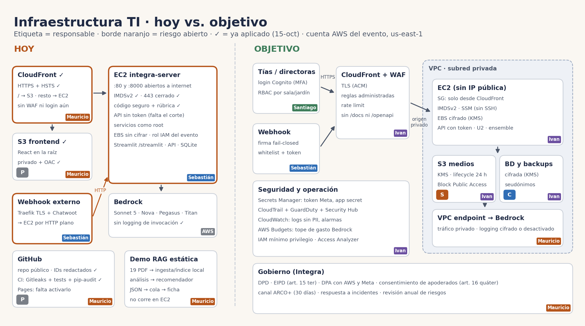

# Plan de seguridad — IntegrAI

> Responsable: Mauricio (seguridad + U2). Revisión: 15-oct-2026. Ver también [`GOBIERNO_DATOS.md`](GOBIERNO_DATOS.md).
> Los artículos de ley citados provienen de un levantamiento con fuentes secundarias: **verificarlos en bcn.cl antes de usarlos formalmente.**

## 1. Por qué este sistema es de alto riesgo

- Trata datos de **niños/as de 0 a 6 años**: observaciones, fotos, audios, videos y una inferencia de **rezago del desarrollo**. Esa inferencia es un dato sensible (desarrollo/salud) según la Ley 19.628 modificada por la **Ley 21.719**, que **entra en vigencia el 1-dic-2026**. Hay un proyecto para postergarla (Boletín 18.623-07), pero no está aprobado.
- Los datos pasan por **terceros**: Meta (WhatsApp), un servidor externo con el webhook (Traefik + Chatwoot), AWS us-east-1 (fuera de Chile) y modelos de Bedrock.
- El sistema **perfila** a niños/as. El art. 8 bis exige **revisión humana efectiva**, explicación y derecho a impugnar. El diseño "la tía confirma" cumple esto si la revisión es real y no un clic automático.
- Multas de hasta **20.000 UTM** por faltas gravísimas: no hacer la EIPD, tratar a sabiendas datos de menores contra la ley u omitir notificar una brecha.

## 2. Hallazgos (auditoría del 15-oct)

Tres revisiones en paralelo: código del repo, infraestructura vista desde fuera y requisitos legales. La auditoría interna de la cuenta AWS (SG, IMDSv2, IAM, CloudTrail, GuardDuty) **quedó pendiente**: las credenciales del evento vencieron. Se repite cuando se renueven.

| # | Hallazgo | Severidad | Estado |
|---|---|---|---|
| H1 | Webhook aceptaba POST **sin firma** si faltaba `WA_APP_SECRET` (fail-open) | Crítica | ✅ Corregido: fail-closed (`webhook/server.py`) |
| H2 | **Sin whitelist**: cualquier número registraba observaciones en el jardín | Crítica | ✅ Corregido: `WA_WHITELIST`; los desconocidos se descartan sin respuesta |
| H3 | API de decisión **sin autenticación**, Swagger público, `/health` con datos del jardín | Crítica | ✅ Corregido en código: `INTEGRA_API_TOKEN`, docs apagados, `/health` mínimo. **Falta desplegar** |
| H4 | **Sin HTTPS** en la EC2 (443 cerrado). El webhook externo reenvía medios de niños por **HTTP plano** | Crítica | ⏳ Ivan: CloudFront o ALB con TLS (F0) |
| H5 | IP, ID de instancia, SG y nombre de la llave publicados en el repo público | Alta | ✅ Redactados (siguen en el historial; la instancia es temporal) |
| H6 | `GET /procesar` y `bench/*` ponían la nota del niño en la URL | Alta | ✅ GET eliminado; bench usa `INTEGRA_API_URL` |
| H7 | Lectura arbitraria de archivos vía `Entrada.ref` (path traversal) | Alta | ✅ `src/seguridad/archivos.ruta_segura` |
| H8 | Sin límite de tamaño ni validación de tipo de medios | Alta | ✅ Tope de 16 MB + magic bytes (webhook, EC2 y U2) |
| H9 | Video enviado al OCR como si fuera imagen (fallaba) | Media (funcional) | ✅ El video se **analiza visualmente** (Pegasus 1.2 vía Bedrock, fallback Nova 2 Lite: postura, apoyo, control de cabeza, desplazamiento) + audio como complemento. **Falta probar en la EC2** con un video real |
| H10 | El clasificador y la BD recibían la **nota cruda con el nombre** del niño | Alta | ✅ U2: se clasifica y guarda el texto en **conductas sin nombres** |
| H11 | Logs con **teléfono y texto completo** (PII de menores) | Alta | ✅ Teléfono enmascarado, solo el largo del texto |
| H12 | Prompt injection: la nota entraba como instrucción al LLM | Media | ✅ La nota va delimitada como datos (`<nota>`) |
| H13 | Errores internos (`repr(e)`) devueltos al usuario | Media | ✅ Mensajes genéricos; el detalle va a logs |
| H14 | Temporales con `mktemp`, nunca borrados | Media | ✅ `NamedTemporaryFile` + borrado en `finally` |
| H15 | Dashboard Streamlit **sin login** | Alta | ⏳ Santiago + Ivan (F1, o F0 con auth básica detrás de CloudFront) |
| H16 | Frontend publica todo `data/` como estático (`publicDir: '../data'`) | Alta | ⏳ Santiago: servir por API con autenticación |
| H17 | **IDOR**: `EDUCADORA_DEMO` fija; no se verifica que la educadora pertenezca al jardín del niño | Alta | ⏳ Sebastián: mapear teléfono → educadora → salas (tabla `educadora_salas` ya existe) |
| H18 | **Chatwoot (fan-out)** guarda las conversaciones en un tercero sin DPA | Alta (legal) | ⏳ Integra/Sebastián: apagar `CHATWOOT_FANOUT` o firmar DPA |
| H19 | Dependencias sin versión fija (`>=`), sin `pip-audit` | Baja | ⏳ CI |
| H20 | `tools/ssm_push.py` arma comandos shell con la ruta remota | Baja | Herramienta interna; no exponer |

## 3. Plan de despliegue por fases

### F0 — Antes de la demo (cierre 16-oct, 10:15)

| Control | Responsable | Cómo | Ley |
|---|---|---|---|
| Desplegar el código de esta rama en la EC2 y en el webhook | Sebastián | `git pull` + reinicio de los servicios | 21.459 |
| Variables obligatorias | Sebastián | Webhook: `WA_APP_SECRET`, `WA_WHITELIST` (teléfonos del equipo), `INTEGRA_API_TOKEN`. EC2: el mismo `INTEGRA_API_TOKEN` | 21.719 art. 14 quinquies |
| TLS hacia la EC2 | Ivan | CloudFront con origen la EC2 (dominio `*.cloudfront.net`, sin comprar uno) y `INTEGRA_BACKEND=https://<id>.cloudfront.net` | 21.719 art. 14 quinquies |
| Security group | Ivan | 80/8000 solo desde el prefix list de CloudFront (`com.amazonaws.global.cloudfront.origin-facing`). Cerrar 22 y 8501; administrar por SSM | — |
| IMDSv2 obligatorio | Ivan | `aws ec2 modify-instance-metadata-options --instance-id <id> --http-tokens required` | — |
| Secretos fuera del disco | Ivan | Secrets Manager para `WA_TOKEN`, `WA_APP_SECRET` e `INTEGRA_API_TOKEN` | — |
| Solo datos sintéticos | Todos | Nada de fotos, audios ni **videos de niños reales** en la demo: los videos se actúan con muñeco o entre adultos. El video es el dato más sensible (imagen del niño/a) | 21.430 art. 33–34 |
| Apagar Chatwoot fan-out | Sebastián | `CHATWOOT_FANOUT=` vacío durante el evento | 21.719 art. 15 bis |
| Mensaje de "propuesta" | Sebastián | El ACK dice que el nivel es una propuesta para el criterio de la tía | 21.719 art. 8 bis |

### F1 — Piloto con Integra (semanas)

| Control | Responsable |
|---|---|
| Login del dashboard con **Cognito u OIDC de Integra** + MFA. RBAC: educadora → su sala, directora → su jardín, regional → solo agregados | Santiago + Ivan |
| AWS WAF con reglas administradas (Common, KnownBadInputs) y regla rate-based | Ivan |
| CloudTrail (multi-región, con validación de logs), GuardDuty, Security Hub (CIS/FSBP), AWS Config | Ivan |
| KMS en EBS, S3 y backups. S3 con Block Public Access y **lifecycle de 24 h** para medios crudos | Ivan |
| Bedrock por **VPC endpoint**. Logging de invocaciones desactivado, o cifrado con retención corta | Ivan + Mauricio |
| Logs sin PII (revisión de todos los `print`), retención de 2 años para auditoría | Mauricio |
| Mapeo teléfono → educadora → salas (cerrar el IDOR H17) | Sebastián |
| **EIPD** firmada (art. 15 ter) y **DPA** con AWS, Meta y el operador del webhook (art. 15 bis) | Integra + Mauricio |
| **Consentimiento de apoderados** documentado y revocable (art. 16 quáter) | Integra |
| AWS Budgets con alerta de gasto en Bedrock | Ivan |
| CI: `pip-audit`, `npm audit`, dependencias fijadas, escaneo de secretos (gitleaks) | Ivan |

### F2 — Producción (antes de dic-2026)

| Control | Responsable |
|---|---|
| Transferencia internacional: **cláusulas contractuales tipo** (Res. Min. Economía, 15-dic-2025), o migrar a la **región AWS Chile** si ya está disponible con Bedrock (arts. 27–28) | Integra + Ivan |
| Número verificado de **WhatsApp Business** de Integra; el webhook pasa a una infraestructura de Integra, no a un servidor personal | Integra + Sebastián |
| **DPD** designado (art. 50) y **modelo de prevención de infracciones** certificable (art. 49) | Integra |
| Canal **ARCO+** para apoderados (30 días) y procedimiento de supresión por niño | Integra + Mauricio |
| **Plan de respuesta a incidentes**: Agencia "sin dilaciones indebidas" + apoderados (art. 14 sexies). CSIRT con alerta en 3 h, 72 h e informe a 15 días como buena práctica (Ley 21.663) | Mauricio |
| Pentest con autorización escrita (Ley 21.459) | Integra |
| Evaluación de sesgo (por sexo y región) y del set "contra la edad" en cada versión del modelo | Mauricio |
| Revisión anual de riesgos y de este documento | Mauricio |

## 4. Controles ya implementados (esta rama)

| Archivo | Control |
|---|---|
| `webhook/server.py` | Firma HMAC fail-closed, comparación en tiempo constante del verify token, whitelist, tope de tamaño, video enviado como video, token hacia el backend, logs sin PII |
| `webhook_ec2.py` | `X-Api-Key` en `/procesar`, `/procesar_media` y `/clasificar`. Sin `GET /procesar`. Swagger apagado (`INTEGRA_DOCS=1` para desarrollo). `/health` mínimo. Magic bytes. Temporales que se borran. U2 delante del ensemble (`U2_CONDUCTAS=1`) |
| `src/seguridad/webhook.py` | `verificar_firma`, `telefono_autorizado` y `enmascarar`, reutilizables |
| `src/seguridad/archivos.py` | `ruta_segura` (confinada a `DIR_MEDIOS`) y `validar_medio` (16 MB + magic bytes) |
| `src/multimodal/*` | Validación previa de cada medio, nota delimitada contra prompt injection, `nino_mencionado` fuera del `detalle`, errores genéricos |
| `tests/test_seguridad.py`, `tests/test_webhook_whatsapp.py` | 9 tests: firma, whitelist, PII en logs, path traversal, magic bytes y tamaño |

## 5. Variables de entorno de seguridad

| Variable | Dónde | Valor |
|---|---|---|
| `WA_APP_SECRET` | webhook | App Secret de Meta (**obligatoria**) |
| `WA_WHITELIST` | webhook | Teléfonos autorizados, separados por coma |
| `INTEGRA_API_TOKEN` | webhook y EC2 | Token aleatorio (`python -c "import secrets;print(secrets.token_urlsafe(32))"`) |
| `INTEGRA_BACKEND` | webhook | URL **https** del servicio de decisión |
| `WA_ALLOW_UNSIGNED` | webhook | Solo `1` en desarrollo local |
| `INTEGRA_DOCS` | EC2 | Solo `1` en desarrollo |
| `U2_CONDUCTAS` | EC2 | `1` (por defecto) |
| `DIR_MEDIOS`, `MAX_MEDIA_BYTES` | EC2 | Directorio de medios temporales y tope |

## 6. Verificación

- `pytest tests/` → 15 tests en verde.
- Después de desplegar: `curl https://<backend>/docs` → 404. `curl -X POST https://<backend>/clasificar?texto=x` sin `X-Api-Key` → 401. Un mensaje desde un número fuera de la whitelist → sin respuesta. Un POST al webhook sin firma → 403.
- Con credenciales AWS renovadas: repetir la auditoría interna (SG, IMDSv2, rol IAM, CloudTrail, GuardDuty, logging de Bedrock) y actualizar la tabla de hallazgos.
